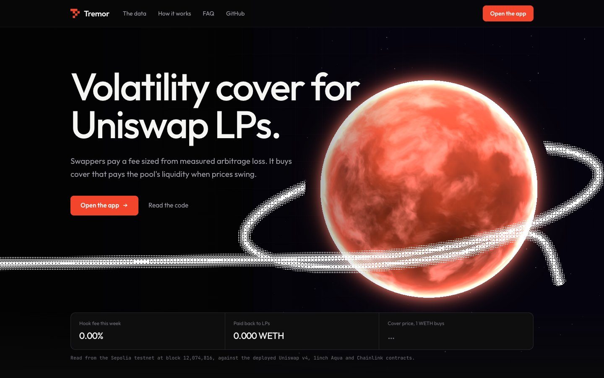
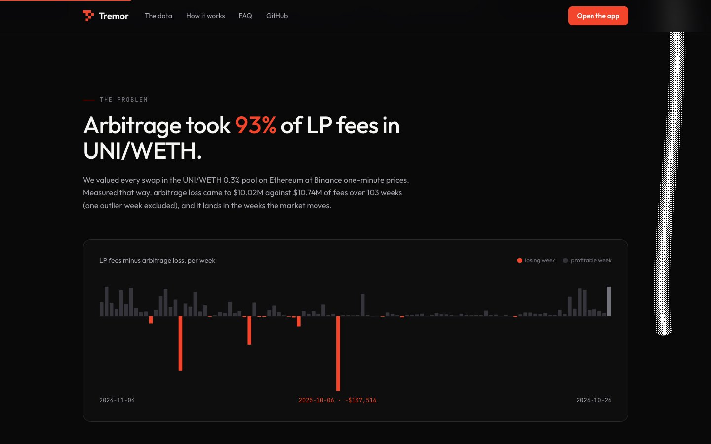
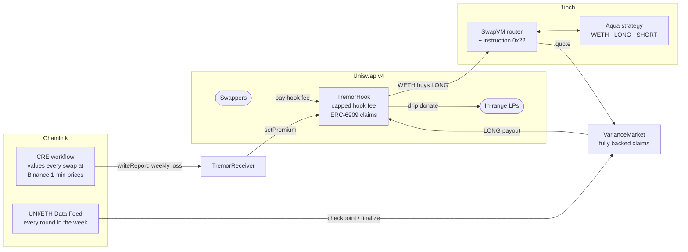
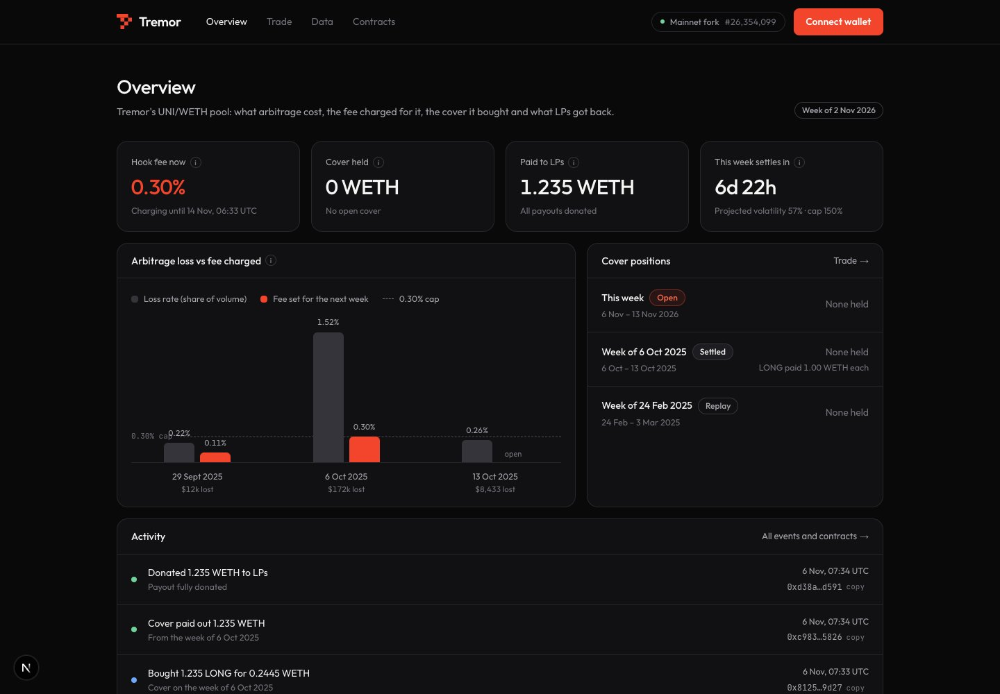
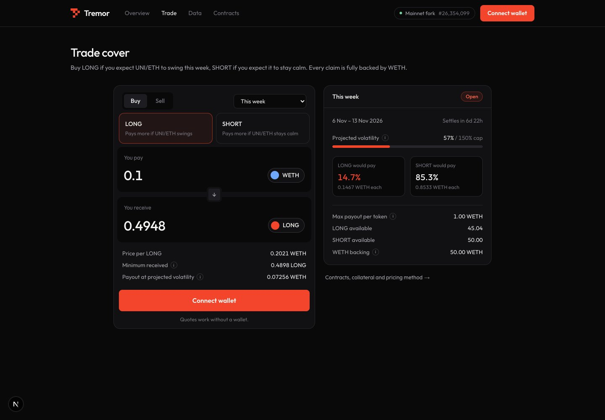
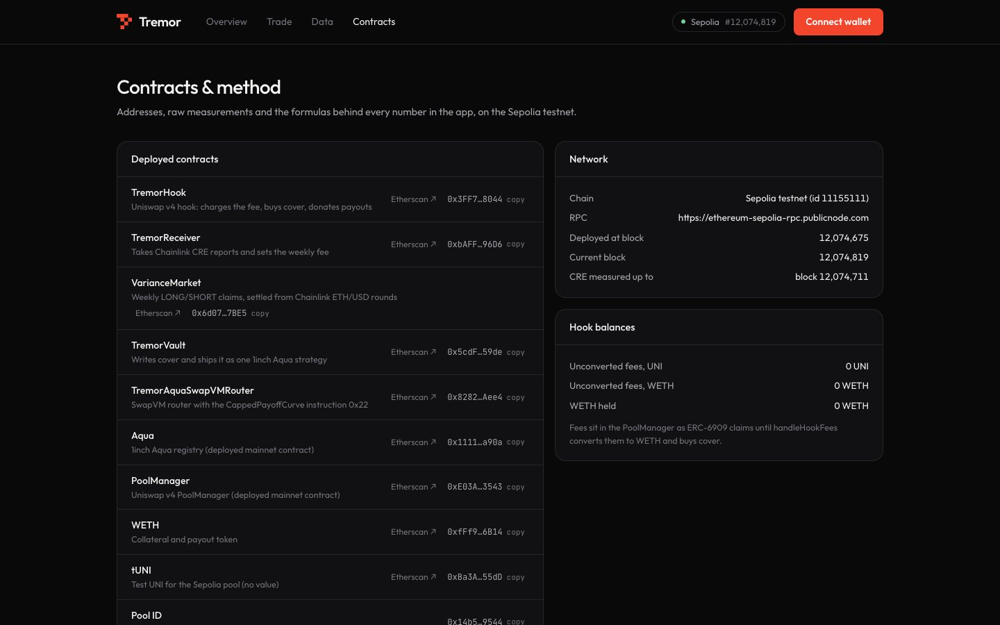

# Tremor

**A Uniswap v4 hook that measures LP adverse selection with Chainlink CRE, buys capped volatility cover on 1inch Aqua, and pays it back into the pool when markets swing.**

**[Live app (Sepolia)](https://tremor-mumbai.vercel.app)** · [Sepolia contracts](#live-on-sepolia) · [Verify every claim](#proof-every-claim-with-its-evidence) · [Run it in 5 minutes](#run-it) · ETHGlobal Mumbai 2026 · MIT



## TL;DR for judges

| | |
|---|---|
| **Problem** | Uniswap LPs are short volatility. In UNI/WETH 0.3% on Ethereum, our swap-by-swap markout puts arbitrage loss at **93% of LP fees** ($10.02M of $10.74M, 103 weeks); LP net was negative in **14 of 104 weeks**, worst **−$137,516** in one week. |
| **Idea** | Charge swappers a small hook fee sized from *measured* loss, and spend it on cover that pays the pool back in the weeks that hurt. |
| **1inch** | A **new SwapVM instruction (`0x22`, `CappedPayoffCurve`)** prices fully collateralized LONG/SHORT volatility claims from **one Aqua strategy** holding `[WETH, LONG, SHORT]`, on the **deployed Aqua registry**. |
| **Uniswap** | A v4 **hook fee** (`BaseHookFee`, `afterSwap` + `afterSwapReturnDelta`) taken as ERC-6909 claims, converted in-pool, spent on cover, and **drip-`donate`d** back to in-range liquidity. |
| **Chainlink** | A **CRE workflow** values every swap against exchange prices and reports the week's loss on-chain, which sets the fee. **Data Feeds** settle the claims from every readable Chainlink round in the week. |
| **Proof** | 65/65 unit tests (including 10,508 cross-language pricing vectors and solvency invariants), 8/8 mainnet-fork tests with asserted historical results, a real `cre workflow simulate` backfill that set the fee to its cap, and a **live Sepolia deployment** with on-chain transactions. |
| **Honesty** | We benchmarked Tremor against simply raising the LP fee: a dynamic fee earns more on average, **Tremor cuts the worst week by 43%**. Both numbers are in this README. |

## The problem, measured



We valued every swap in the UNI/WETH 0.3% pool on Ethereum at Binance one-minute prices for 104 weeks ([method](data/README.md#method), [data](data/full_104w.json)). It is our measurement, not a third-party figure.

| Measured (UNI/WETH 0.3%, Ethereum) | Value | Basis |
|---|---|---|
| Arbitrage loss as a share of LP fees | **93%** ($10.02M of $10.74M) | 103 weeks; one documented outlier week excluded |
| Weeks with negative LP net | **14 of 104** | all weeks |
| Worst week (6 Oct 2025) | loss **$172,486** vs fees $34,971 → LP net **−$137,516** | single week |
| LP net over the period | **+$0.72M** | 103 weeks: thin, unpredictable margins |

Losses cluster exactly when the market moves. That is the shape cover is for.

## How it works



1. **Measure.** Each hour a Chainlink CRE workflow reads the pool's swap logs, prices every swap against Binance one-minute candles in node mode, reaches consensus on six integers and writes a report to `TremorReceiver`.
2. **Charge.** When a week closes, the receiver sets the hook fee to `min(0.30%, 0.5 × loss ÷ volume)`. No fresh report means the fee expires to zero.
3. **Cover.** The hook redeems its fee claims, converts UNI to WETH in the same pool, and buys LONG claims on the week's realized volatility through the `0x22` instruction. LONG pays `S × min(V, Vcap) ÷ Vcap`; SHORT pays the rest, so every pair is backed by exactly `S` WETH.
4. **Pay.** At settlement the market reads every Chainlink round in the week (within one proxy phase), the hook redeems LONG for WETH, and drips it to in-range liquidity with `PoolManager.donate`.

## Sponsor integrations

### 1inch: a new SwapVM instruction on the deployed Aqua registry

- **`CappedPayoffCurve` at opcode `0x22`**, appended after swap-vm v1.0.2's 34 official instructions (indices unchanged). It reads both claim balances of the strategy straight from Aqua, prices the trade through the market with the strategy's inventory skew, and refuses fills larger than inventory. [`CappedPayoffCurve.sol#L25`](contracts/src/aqua/CappedPayoffCurve.sol#L25), Aqua reads [`#L44-L45`](contracts/src/aqua/CappedPayoffCurve.sol#L44-L45), inventory guard [`#L58`](contracts/src/aqua/CappedPayoffCurve.sol#L58).
- **Router:** AquaSwapVMRouter v1.0.2 plus `0x22`, a redeployment the prize rules allow, constructed against the deployed Aqua registry. [`TremorAquaSwapVMRouter.sol#L12-L37`](contracts/src/aqua/TremorAquaSwapVMRouter.sol#L12-L37). Runtime **21,935 bytes** (EIP-170 limit 24,576).
- **One strategy, three tokens:** the vault mints complete sets, builds the SwapVM program and ships `[WETH, LONG, SHORT]` as a single Aqua strategy. [`TremorVault.sol#L48`](contracts/src/aqua/TremorVault.sol#L48), program [`#L75`](contracts/src/aqua/TremorVault.sol#L75), `aqua.ship` [`#L104`](contracts/src/aqua/TremorVault.sol#L104). N WETH backs 2N claims, so the strategy can never owe more than it holds.
- **Why it matters:** without Aqua and the instruction there is no market for the cover. It is the product, not a decoration.
- **Proof:** `quote == swap` for buys and sells through `0x22` ([`test_A2`](contracts/test/fork/TremorFork.t.sol#L98)); a live Sepolia buy that filled exactly at its quote ([tx](https://sepolia.etherscan.io/tx/0xd905bf07785c2c66bf4c1cc68fa39d5ec9ba792b3dc3a04a16e5c2bcb2e95dd5)).

### Uniswap: a hook fee that buys cover and donates it back

- **Hook fee, not an LP fee:** OpenZeppelin `BaseHookFee` with `afterSwap` + `afterSwapReturnDelta` (address flags `0x44`), charged on the unspecified currency as ERC-6909 claims, capped at 3,000 pips ([`#L53`](contracts/src/hook/TremorHook.sol#L53)). `setPremium` [`#L133`](contracts/src/hook/TremorHook.sol#L133), `_getHookFee` [`#L142`](contracts/src/hook/TremorHook.sol#L142).
- **Fees to cover:** `handleHookFees` redeems the claims and converts UNI to WETH in the same pool with a Chainlink price limit, then buys cover outside the unlock. [`#L155`](contracts/src/hook/TremorHook.sol#L155), [`_convertToWeth #L304`](contracts/src/hook/TremorHook.sol#L304), [`_buyCover #L168`](contracts/src/hook/TremorHook.sol#L168).
- **Cover to LPs:** `claimPayout` [`#L244`](contracts/src/hook/TremorHook.sol#L244) redeems settled LONG; `drip` [`#L269`](contracts/src/hook/TremorHook.sol#L269) donates it over a few hundred blocks via `unlockCallback` [`#L280`](contracts/src/hook/TremorHook.sol#L280).
- **Hook address mining** with CREATE2: [`DeployFork.s.sol#L26`](contracts/script/DeployFork.s.sol#L26).
- **Positioning:** Uniswap Labs' VolatilePair prices volatility into the LP fee; Tremor is a permissionless alternative that turns the same signal into tradable cover.
- **Proof:** hook fee equals `ceil(gross × pips / 1e6)` in both directions and a stale premium charges zero ([`test_U1`](contracts/test/fork/TremorFork.t.sol#L193), [`#L223`](contracts/test/fork/TremorFork.t.sol#L223)); the full loop on a fork ([`test_E2E`](contracts/test/fork/TremorFork.t.sol#L243)). Developer feedback: [`FEEDBACK.md`](FEEDBACK.md).

### Chainlink: CRE measures the loss, Data Feeds settle the cover

- **CRE workflow** ([`cre/tremor-lvr`](cre/tremor-lvr)): per run, 1 + 12 + 2 EVM reads (receiver state [`workflow.ts#L125`](cre/tremor-lvr/workflow.ts#L125), swap logs in 100-block chunks [`#L189`](cre/tremor-lvr/workflow.ts#L189), block timestamps via Multicall3 [`#L125`](cre/tremor-lvr/workflow.ts#L125)), 2 Binance HTTP calls in node mode ([`#L221-L224`](cre/tremor-lvr/workflow.ts#L221-L224)), deterministic integer maths ([`lvr.ts#L195`](cre/tremor-lvr/lvr.ts#L195)), and one `writeReport` ([`#L305-L307`](cre/tremor-lvr/workflow.ts#L305-L307)). Within the 15-read, 15-call limits.
- **Receiver:** contiguous spans only ([`TremorReceiver.sol#L87-L95`](contracts/src/hook/TremorReceiver.sol#L87-L95)); at each weekly close it sets the hook fee ([`#L126-L134`](contracts/src/hook/TremorReceiver.sol#L126-L134)). CRE data moves the fee, never the payouts.
- **Data Feeds settlement:** `checkpoint` ingests every round in the window ([`VarianceMarket.sol#L156`](contracts/src/VarianceMarket.sol#L156)), phase-aware and never stitching phases ([`_anchor #L367`](contracts/src/VarianceMarket.sol#L367)); `finalize` settles on the full set ([`#L193`](contracts/src/VarianceMarket.sol#L193)); quotes pause until the newest round is ingested ([`caughtUp #L276`](contracts/src/VarianceMarket.sol#L276)).
- **Proof:** a 42-run `cre workflow simulate` backfill of the 6 Oct 2025 week measured **1,931 swaps and $168,022** of loss (backtest: $172,486) and closed the week with **3,000 pips** from CRE data alone ([results](cre/README.md#simulation-results-6-nov-2026-anvil-fork-of-mainnet-at-block-26352198-from-rpcmevblockerio)); a CRE report through the Sepolia forwarder ([tx](https://sepolia.etherscan.io/tx/0x4fe0aad6a9f56f01917e29329e4655283c180a248c3fe8f098e205cfed0fba5a)); the TypeScript maths matches the Python reference on a real crash hour ([`validate.ts`](cre/scripts/validate.ts)).

## The app

<table>
<tr>
<td width="50%"><br/><sub><b>Overview</b> (mainnet-fork demo): the 0.30% fee set from measured loss, 1.235 WETH paid to LPs, and the plain-language activity feed.</sub></td>
<td width="50%"><br/><sub><b>Trade</b>: one swap card through instruction <code>0x22</code>; the panel shows time to settlement, projected volatility against the cap, and what LONG and SHORT would pay.</sub></td>
</tr>
</table>


<sub><b>Contracts & method</b> on the live Sepolia deployment: every address with an Etherscan link, network state, weekly measurements and the formulas.</sub>

## Proof: every claim with its evidence

Everything below is reproducible from this repo. "Asserted" means a test fails if the number changes.

| Claim | Evidence | Check it |
|---|---|---|
| 65/65 unit tests pass, including 10,508 pricing vectors from a separate exact-rational Python model | [`contracts/test/unit`](contracts/test/unit), [`reference/pricing_reference.py`](reference/pricing_reference.py) | `forge test --match-path 'test/unit/*'` |
| Solvency: the market always holds the WETH for every claim; every claim stays redeemable | invariant fuzzing, [`VarianceMarketInvariant.t.sol#L140-L163`](contracts/test/unit/VarianceMarketInvariant.t.sol#L140-L163) | same |
| `quote == swap` through `0x22` on the deployed Aqua registry | [`test_A2`](contracts/test/fork/TremorFork.t.sol#L98) | `forge test --match-path 'test/fork/*' -vv` |
| The router fits EIP-170 (21,935 bytes) | [`test_A1`](contracts/test/fork/TremorFork.t.sol#L88) | same |
| Oct 2025 week settles from **50** real Chainlink rounds, 305% vol, LONG pays **1.0** (asserted) | [`test_C1`](contracts/test/fork/TremorFork.t.sol#L150) | same |
| Feb 2025 week settles from **17** rounds, 59.8% vol, LONG pays **0.159** (asserted) | [`test_C1`](contracts/test/fork/TremorFork.t.sol#L150) | same |
| Full loop: CRE fee → swaps pay it → cover bought → Chainlink settlement → WETH donated to LPs | [`test_E2E`](contracts/test/fork/TremorFork.t.sol#L243), [`demo/run-demo.sh`](demo/run-demo.sh): fee 0 → 1,121 → 3,000 pips, 1.235 LONG bought for 0.2445 WETH, **1.235 WETH donated** | `./demo/setup-fork.sh && ./demo/run-demo.sh` |
| A real CRE simulation sets the fee from on-chain data | 42-run backfill, `EpochClosed`, fee → 3,000 pips ([details](cre/README.md#simulation-results-6-nov-2026-anvil-fork-of-mainnet-at-block-26352198-from-rpcmevblockerio)) | `cre/backfill.sh 23565081` |
| CRE maths equals the Python method | [`cre/scripts/validate.ts`](cre/scripts/validate.ts) on a real crash hour (122 swaps), within $1e-5 | `bun run cre/scripts/validate.ts` |
| Quotes never use stale oracle data | [`test_quote_reverts_when_newer_round_not_ingested`](contracts/test/unit/VarianceMarket.t.sol#L872); live on Sepolia: quote reverted `Stale()`, then a [checkpoint](https://sepolia.etherscan.io/tx/0xb4ba6b3c3269c58eac0585d4bcebeda70e621661ef99a3aa4d6c443b02d05861) and a [fill at the quote](https://sepolia.etherscan.io/tx/0xd905bf07785c2c66bf4c1cc68fa39d5ec9ba792b3dc3a04a16e5c2bcb2e95dd5) | Etherscan |
| Payouts can't be delayed by anyone re-claiming | [`test_E2E`](contracts/test/fork/TremorFork.t.sol#L243) asserts re-claims revert `NothingToClaim` | fork tests |
| Live on a public chain against the real v4 PoolManager and Aqua | [Sepolia addresses](#live-on-sepolia), [`contracts/deployments/sepolia.json`](contracts/deployments/sepolia.json) | Etherscan |
| The economics, including where Tremor loses | [equal-cost benchmark](#the-economics-honestly) | `python3 data/benchmark_dynamic_fee.py` |

## Live on Sepolia

Deployed 6 Nov 2026 against the real Uniswap v4 PoolManager and the 1inch Aqua registry (byte-identical to mainnet's). App: **https://tremor-mumbai.vercel.app**.

| Contract | Address |
|---|---|
| TremorHook | [`0x3FF7250cB8BBC51DefC8eB4fEB3cFa9A05ae8044`](https://sepolia.etherscan.io/address/0x3FF7250cB8BBC51DefC8eB4fEB3cFa9A05ae8044) |
| TremorReceiver | [`0xbAFFE70d8D310dF3Da938D06d20e5C0949cD96D6`](https://sepolia.etherscan.io/address/0xbAFFE70d8D310dF3Da938D06d20e5C0949cD96D6) |
| VarianceMarket | [`0x6d07B9157d4c63F5BC2B5a1dA04E3A883e9B7BE5`](https://sepolia.etherscan.io/address/0x6d07B9157d4c63F5BC2B5a1dA04E3A883e9B7BE5) |
| TremorVault | [`0x5cdF7cADd39d37Cf4570815F407a4f4c5bb059de`](https://sepolia.etherscan.io/address/0x5cdF7cADd39d37Cf4570815F407a4f4c5bb059de) |
| TremorAquaSwapVMRouter (`0x22`) | [`0x8282596eBef54837b99392d4d09534251Fa7Aee4`](https://sepolia.etherscan.io/address/0x8282596eBef54837b99392d4d09534251Fa7Aee4) |
| tUNI (test token) | [`0xBa3AF5f6d46ED19C39E4C9E21740e30FBC8155dD`](https://sepolia.etherscan.io/address/0xBa3AF5f6d46ED19C39E4C9E21740e30FBC8155dD) |

On-chain evidence:
- **Oracle safety, live:** a new Chainlink ETH/USD round arrived after the window opened, `caughtUp(0)` was false and the router's quote reverted `Stale()`. A permissionless `checkpoint` ([tx](https://sepolia.etherscan.io/tx/0xb4ba6b3c3269c58eac0585d4bcebeda70e621661ef99a3aa4d6c443b02d05861)) restored quotes, and a buy through `0x22` filled exactly at the quote: 0.002 WETH for 9.6919 LONG ([tx](https://sepolia.etherscan.io/tx/0xd905bf07785c2c66bf4c1cc68fa39d5ec9ba792b3dc3a04a16e5c2bcb2e95dd5)).
- **CRE on a public chain:** a report through the Sepolia MockKeystoneForwarder advanced the receiver ([tx](https://sepolia.etherscan.io/tx/0x4fe0aad6a9f56f01917e29329e4655283c180a248c3fe8f098e205cfed0fba5a)).
- **A full fee week, closed by CRE alone** (first deployment, before the review fixes): `EpochClosed` with −$0.034 of measured loss on $28.02 of volume, so the fee was set to **0%** ([tx](https://sepolia.etherscan.io/tx/0x26229855a052b6ca9540837af7c9569ed58081d088a55dc7e9d751b2ddcbfb1c)). Correct: our test sale below market and the arbitrage back (−$2.46, +$2.50) leave LPs unharmed.

Sepolia differences (same contracts): settlement on **Chainlink ETH/USD** (Sepolia has no UNI/ETH feed); a **test UNI** pool started at the mainnet UNI/ETH price; **0.001 WETH** per LONG+SHORT pair with the price slope and skew scaled to match; the first fee week closes 2 hours after deploy so CRE can set the fee during testing. Sepolia reprices state-growth gas (the router deployment used 34.3M gas), so [`demo/deploy-sepolia.sh`](demo/deploy-sepolia.sh) simulates with forge and sends each transaction with the node's own estimate.

## Run it

**Live:** open https://tremor-mumbai.vercel.app with a wallet on Sepolia. If you hold ETH but no WETH, the trade button wraps it for you.

**Local mainnet fork (about 5 minutes):**

```bash
git clone https://github.com/zeel991/tremor-mumbai.git && cd tremor-mumbai && git submodule update --init && cd contracts && npm install
```

```bash
anvil --fork-url https://ethereum-rpc.publicnode.com --chain-id 1 --compute-units-per-second 150 --retries 12
```

```bash
forge test --match-path 'test/unit/*' && forge test --match-path 'test/fork/*' -vv
```

```bash
../demo/setup-fork.sh && ../demo/run-demo.sh
```

```bash
cd ../web && npm install && npm run dev
```

A publicnode fork stops serving new state after about an hour; start a fresh one if it does. `run-demo.sh` is one-shot per deploy (it finalizes the replay window). For the Sepolia build locally: `npm run dev:sepolia`.

## The economics, honestly

We compared Tremor with the obvious alternative: send the same weekly add-on straight to LPs as a dynamic fee. Same two years, 102 week pairs ([`data/benchmark_dynamic_fee.py`](data/benchmark_dynamic_fee.py)). LONG is bought at the deployed ask (0.1967 per 1.0 maximum payout) and pays on Binance-sampled volatility × 0.70, the Chainlink-to-Binance ratio observed in both replayed weeks. B gets flat pricing, unlimited depth and same-week payout, which flatters it.

| LP net per week | Total | Mean | Sd | Worst week | Negative weeks |
|---|---|---|---|---|---|
| Today (no add-on) | $693,352 | $6,798 | $23,701 | −$137,516 | 14 |
| A: dynamic LP fee | **$5,522,180** | **$54,139** | **$67,381** | −$124,446 | **1** |
| B: Tremor cover | $5,088,952 | $49,892 | $99,962 | **−$71,061** | 2 |

**A direct fee wins on mean and smoothness; Tremor gives up about 8% of the add-on to cut the worst week by 43%.** Tremor is for reshaping the tail, not raising the average. Volume lost to the add-on scales A and B alike. The fee rule raises funding equal to at most 49% of measured loss, an upper bound that assumes no lost volume.

## Security and review

Not audited. An external review on 6 Nov 2026 found two correctness bugs; both are fixed, tested and redeployed:
- **Stale quotes:** the market could price from stored data while a newer Chainlink round was public, and after the window ended. Quotes now revert (`Stale`, `TooLate`) until `checkpoint` catches up ([`#L300-L301`](contracts/src/VarianceMarket.sol#L300-L301)); the hook checkpoints a running window before buying.
- **Drip griefing:** anyone could restart the payout drip with an empty claim. Each window the hook bought cover in can now be claimed once ([`TremorHook.sol#L244`](contracts/src/hook/TremorHook.sol#L244)).

A second correctness review the same day found eight more issues. All are fixed with regression tests, in the contracts on `main` and the mainnet-fork deployment. **The Sepolia contracts predate these fixes** (see Limits):
- **Oracle gaps and phase changes:** an unreadable round below the latest one now counts as a gap, not the end of the feed, so the market won't settle on partial variance ([`caughtUp`](contracts/src/VarianceMarket.sol), `OracleGap`). If the Chainlink proxy changes phase, or a gap never recovers, `settleFallback` settles the window 7 days after normal settlement at the forward variance fixed at creation. Claims stay redeemable, and nobody chooses the outcome after seeing prices.
- **Fee capacity:** `handleHookFees` buys only the largest amount the Aqua strategy can fill and keeps the rest (`CoverDeferred`). An oversized balance no longer reverts it (fork test U1b).
- **Skipped epochs:** each premium expires on the absolute epoch schedule. If reports skip a whole epoch, the stale measurement sets 0.
- **Conversion feed:** the UNI to WETH guard checks `updatedAt`, `answeredInRound`, a 25 h maximum age and `decimals`; if the feed fails, the hook skips conversion.
- **Report authentication:** the Sepolia receiver takes reports from the CRE simulation forwarder (`MockKeystoneForwarder`), which relays anyone's report with placeholder metadata, so a workflow ID or author check can't authenticate it. New deployments therefore restrict delivery to our CRE signer (`reportSubmitter`). With a real KeystoneForwarder, set the expected workflow ID and author instead.
- **CRE live mode:** spans end at head minus 64 confirmations, so the workflow never reports blocks that can still reorg (still 15 EVM reads: 11 log chunks plus a head read). Binance candles must be contiguous 60-second rows with positive prices, or the run fails without reporting.
- **Vault lifecycle:** `settle` docks a still-shipped strategy first, and a strategy can't be docked twice. `collateralView` now reports locked WETH and sets issued.

Earlier, the independent Python pricing model caught five rounding and fill bugs before the contracts shipped; its 10,508 vectors now gate every change.

## Limits

- **Pool-level data.** Individual LPs, especially concentrated ones, can do better or worse than the pool total.
- **Recipients.** `donate` pays the liquidity in range when the payout drips, which may include liquidity that arrived after the loss.
- **Prototype pricing.** A LONG costs about 0.20 and sells for about 0.10 of a 1.0 maximum payout; over the sample LONG returns 91% of its price, which pays SHORT writers for supplying cover.
- **Oracle sampling.** The UNI/ETH feed updates about 4 times a day, so windows are at least 7 days; Chainlink-sampled volatility runs about 0.70× the Binance-sampled figure.
- **Historical replay.** The Oct and Feb 2025 weeks are replayed on a mainnet fork from real Chainlink history; the replay build prices them before ingesting their rounds on purpose.
- **JIT liquidity.** Donations can be front-run by just-in-time liquidity; dripping limits the value per call but does not stop it.
- **New pool.** Tremor runs on a new v4 pool, so LPs would have to move to it.
- **Sepolia deployment predates the second review's fixes.** Its receiver accepts reports from anyone through the simulation forwarder, and its contracts lack the oracle fallback and the fee-capacity fix. Redeploying it with `demo/deploy-sepolia.sh` applies them.

## Repository map

```
contracts/src/
  VarianceMarket.sol            weekly LONG/SHORT claims, Chainlink settlement, pricing
  libraries/Pricing.sol         closed-form quote maths (vector-tested)
  aqua/CappedPayoffCurve.sol    SwapVM instruction 0x22
  aqua/TremorAquaSwapVMRouter.sol  AquaSwapVMRouter v1.0.2 + 0x22
  aqua/TremorVault.sol          writes cover, ships the Aqua strategy
  hook/TremorHook.sol           v4 hook fee → cover → drip donate
  hook/TremorReceiver.sol       CRE reports → weekly fee
contracts/test/                 unit, invariant, vector and mainnet-fork tests
cre/tremor-lvr/                 Chainlink CRE workflow (TypeScript)
data/                           104-week measurement, backtest, benchmark
web/                            Next.js app (landing, Overview, Trade, Data, Contracts)
demo/                           fork deploy + end-to-end demo, Sepolia deploy
docs/                           spec, plan, sponsor source checks, video script
```

## Licences

Tremor's code is MIT ([`LICENSE`](LICENSE)). Dependencies keep their own licences: 1inch swap-vm (`LicenseRef-Degensoft-SwapVM-1.1`), Aqua (`Aqua-Source-1.1`), and the Chainlink `ReceiverTemplate` (MIT, vendored from the CRE docs). AI use is disclosed in [`AI_USAGE.md`](AI_USAGE.md).

**Docs:** [spec](docs/spec.md) · [build plan](docs/tremor_mumbai_plan.md) · [sponsor source checks](docs/research/) · [CRE workflow](cre/README.md) · [data method](data/README.md) · [Uniswap feedback](FEEDBACK.md)
