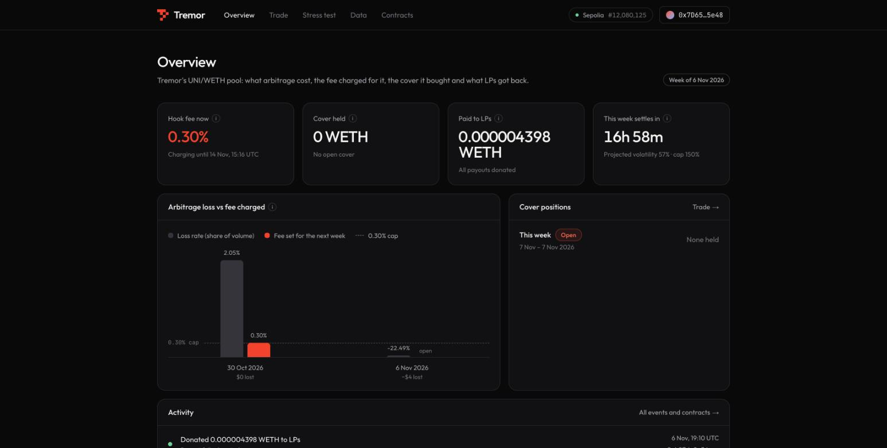
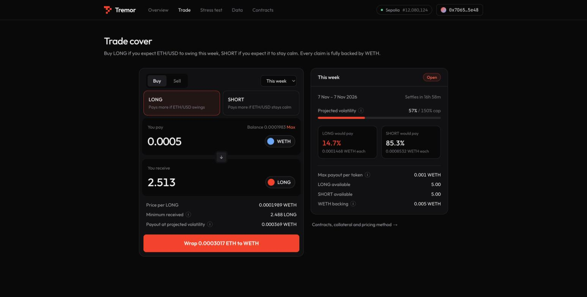
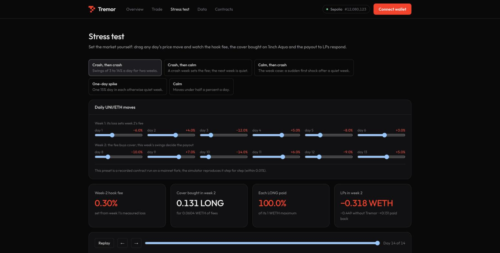

# Tremor

**Volatility cover for Uniswap LPs, paid for by swappers.** A Uniswap v4 hook measures LP arbitrage loss with **Chainlink CRE**, charges a fee sized from it, buys capped volatility cover through a **new 1inch SwapVM instruction on Aqua**, and donates the payout back to the pool's LPs when markets swing.

**[▶ Live app on Sepolia](https://tremor-mumbai.vercel.app)** · [Trade cover](https://tremor-mumbai.vercel.app/app/trade) · [Stress-test simulator](https://tremor-mumbai.vercel.app/app/stress) · [On-chain proof](#live-on-sepolia) · [Every claim, verified](#proof-every-claim-with-its-evidence) · [Run it in 5 minutes](#run-it)

`Uniswap v4 hook` · `1inch Aqua + SwapVM 0x22` · `Chainlink CRE + Data Feeds` · `107 tests passing` · `live on Sepolia` · ETHGlobal Mumbai 2026 · MIT


## TL;DR for judges

| | |
|---|---|
| **Problem** | Uniswap LPs are short volatility. In UNI/WETH 0.3% on Ethereum, our swap-by-swap markout puts arbitrage loss at **93% of LP fees** ($10.02M of $10.74M, 103 weeks); LP net was negative in **14 of 104 weeks**, worst **−$137,516** in one week. |
| **Idea** | Charge swappers a small hook fee sized from *measured* loss, and spend it on cover that pays the pool back in the weeks that hurt. |
| **1inch** | A **new SwapVM instruction (`0x22`, `CappedPayoffCurve`)** prices fully collateralized LONG/SHORT volatility claims from **one Aqua strategy** holding `[WETH, LONG, SHORT]`, on the **deployed Aqua registry**. |
| **Uniswap** | A v4 **hook fee** (`BaseHookFee`, `afterSwap` + `afterSwapReturnDelta`) taken as ERC-6909 claims, spent on cover, and **drip-`donate`d** back to in-range liquidity, with OpenZeppelin's `LiquidityPenaltyHook` keeping payouts for LPs who stay. |
| **Chainlink** | A **CRE workflow** values every swap against exchange prices and reports the week's loss on-chain, which sets the fee. **Data Feeds** settle the claims from every Chainlink round in the week. |
| **Result** | In a two-year backtest on real UNI/WETH data, the worst LP week goes from **−$137,516 to −$71,061** and losing weeks from **14 to 2**. Replaying the October 2025 crash on a mainnet fork, cover paid **in full** and **1.235 WETH** went back to LPs. |
| **Proof** | **107 tests**: 65 unit (10,508 cross-language pricing vectors, solvency invariants), 8 mainnet-fork with asserted historical results, 29 red-team attacks against the real Aqua and v4 contracts, 5 price-shock scenarios. The **full loop runs live on Sepolia**, and the app's **stress-test simulator** reproduces recorded contract runs to within 0.01%. |

## The problem, measured


We valued every swap in the UNI/WETH 0.3% pool on Ethereum at Binance one-minute prices for 104 weeks ([method](data/README.md#method), [data](data/full_104w.json)). Our own swap-by-swap measurement, fully reproducible from the repo.

| Measured (UNI/WETH 0.3%, Ethereum) | Value | Basis |
|---|---|---|
| Arbitrage loss as a share of LP fees | **93%** ($10.02M of $10.74M) | 103 weeks; one documented outlier week excluded |
| Weeks with negative LP net | **14 of 104** | all weeks |
| Worst week (6 Oct 2025) | loss **$172,486** vs fees $34,971 → LP net **−$137,516** | single week |
| LP net over the period | **+$0.72M** | 103 weeks: thin, unpredictable margins |

Losses cluster exactly when the market moves. That is the shape cover is for.

## How it works


1. **Measure.** Each hour a Chainlink CRE workflow reads the pool's swap logs, prices every swap against Binance one-minute candles in node mode, reaches consensus on six integers and writes a report to `TremorReceiver`.
2. **Charge.** When a week closes, the receiver sets the hook fee to `min(0.30%, 0.5 × loss ÷ volume)`. No fresh report means the fee expires to zero.
3. **Cover.** The hook redeems its fee claims, converts UNI to WETH in the same pool, and buys LONG claims on the week's realized volatility through the `0x22` instruction. LONG pays `S × min(V, Vcap) ÷ Vcap`; SHORT pays the rest, so every pair is backed by exactly `S` WETH.
4. **Pay.** At settlement the market reads every Chainlink round in the week (within one proxy phase), the hook redeems LONG for WETH, and drips it to in-range liquidity with `PoolManager.donate`.

## Sponsor integrations

### 1inch: a new SwapVM instruction on the deployed Aqua registry

- **`CappedPayoffCurve` at opcode `0x22`**, appended after swap-vm v1.0.2's 34 official instructions (indices unchanged). It reads both claim balances of the strategy straight from Aqua, prices the trade through the market with the strategy's inventory skew, and refuses fills larger than inventory. [`CappedPayoffCurve.sol#L25`](contracts/src/aqua/CappedPayoffCurve.sol#L25), Aqua reads [`#L44-L45`](contracts/src/aqua/CappedPayoffCurve.sol#L44-L45), inventory guard [`#L58`](contracts/src/aqua/CappedPayoffCurve.sol#L58).
- **Router:** AquaSwapVMRouter v1.0.2 plus `0x22`, a redeployment the prize rules allow, constructed against the deployed Aqua registry. [`TremorAquaSwapVMRouter.sol#L12-L37`](contracts/src/aqua/TremorAquaSwapVMRouter.sol#L12-L37). Runtime **21,935 bytes** (EIP-170 limit 24,576).
- **One strategy, three tokens:** the vault mints complete sets, builds the SwapVM program and ships `[WETH, LONG, SHORT]` as a single Aqua strategy. [`TremorVault.sol#L65`](contracts/src/aqua/TremorVault.sol#L65), program [`#L93`](contracts/src/aqua/TremorVault.sol#L93), `aqua.ship` [`#L122`](contracts/src/aqua/TremorVault.sol#L122). N WETH backs 2N claims, so the strategy can never owe more than it holds.
- **Why it matters:** without Aqua and the instruction there is no market for the cover. It is the product, not a decoration.
- **Proof:** `quote == swap` for buys and sells through `0x22` ([`test_A2`](contracts/test/fork/TremorFork.t.sol#L99)); a Sepolia buy (first deployment) that filled exactly at its quote ([tx](https://sepolia.etherscan.io/tx/0xd905bf07785c2c66bf4c1cc68fa39d5ec9ba792b3dc3a04a16e5c2bcb2e95dd5)), and the hook's own cover buys through `0x22` on the current deployment ([window 0](https://sepolia.etherscan.io/tx/0x180dd947b4c0746d20fb6ab33daf7e6d7c7a838ccf25ca7996301958b7aa0032), [window 2](https://sepolia.etherscan.io/tx/0x4b6068de0df3bf4db82c0a3fb94ce156ad5b8e289e8c93de671317f8c50b2142)).

### Uniswap: a hook fee that buys cover and donates it back

- **Hook fee, not an LP fee:** OpenZeppelin `BaseHookFee` with `afterSwap` + `afterSwapReturnDelta` (address flags `0x547`, with OpenZeppelin `LiquidityPenaltyHook` against JIT liquidity), charged on the unspecified currency as ERC-6909 claims, capped at 3,000 pips ([`#L68`](contracts/src/hook/TremorHook.sol#L68)). `setPremium` [`#L276`](contracts/src/hook/TremorHook.sol#L276), `_getHookFee` [`#L285`](contracts/src/hook/TremorHook.sol#L285).
- **Fees to cover:** `handleHookFees` redeems the claims and converts UNI to WETH in the same pool with a Chainlink price limit, then buys cover outside the unlock. [`#L298`](contracts/src/hook/TremorHook.sol#L298), [`_convertToWeth #L479`](contracts/src/hook/TremorHook.sol#L479), [`_buyCover #L311`](contracts/src/hook/TremorHook.sol#L311).
- **Cover to LPs:** `claimPayout` [`#L418`](contracts/src/hook/TremorHook.sol#L418) redeems settled LONG; `drip` [`#L443`](contracts/src/hook/TremorHook.sol#L443) donates it over a few hundred blocks via `unlockCallback`; liquidity added and removed within 100 blocks forfeits its share to the LPs who stayed [`#L454`](contracts/src/hook/TremorHook.sol#L454).
- **Hook address mining** with CREATE2: [`DeployFork.s.sol#L26`](contracts/script/DeployFork.s.sol#L26).
- **Positioning:** Uniswap Labs' VolatilePair prices volatility into the LP fee; Tremor is a permissionless alternative that turns the same signal into tradable cover.
- **Proof:** hook fee equals `ceil(gross × pips / 1e6)` in both directions and a stale premium charges zero ([`test_U1`](contracts/test/fork/TremorFork.t.sol#L194), [`#L224`](contracts/test/fork/TremorFork.t.sol#L224)); the full loop on a fork ([`test_E2E`](contracts/test/fork/TremorFork.t.sol#L244)). Developer feedback: [`FEEDBACK.md`](FEEDBACK.md).

### Chainlink: CRE measures the loss, Data Feeds settle the cover

- **CRE workflow** ([`cre/tremor-lvr`](cre/tremor-lvr)): per run, 1 + 12 + 2 EVM reads (receiver state [`workflow.ts#L125`](cre/tremor-lvr/workflow.ts#L125), swap logs in 100-block chunks [`#L189`](cre/tremor-lvr/workflow.ts#L189), block timestamps via Multicall3 [`#L139`](cre/tremor-lvr/workflow.ts#L139)), 2 Binance HTTP calls in node mode ([`#L221-L224`](cre/tremor-lvr/workflow.ts#L221-L224)), deterministic integer maths ([`lvr.ts#L195`](cre/tremor-lvr/lvr.ts#L195)), and one `writeReport` ([`#L305-L307`](cre/tremor-lvr/workflow.ts#L305-L307)). Within the 15-read, 15-call limits.
- **Receiver:** contiguous spans only ([`TremorReceiver.sol#L87-L95`](contracts/src/hook/TremorReceiver.sol#L87-L95)); at each weekly close it sets the hook fee ([`#L126-L134`](contracts/src/hook/TremorReceiver.sol#L126-L134)). CRE data moves the fee, never the payouts.
- **Data Feeds settlement:** `checkpoint` ingests every round in the window ([`VarianceMarket.sol#L188`](contracts/src/VarianceMarket.sol#L188)), phase-aware and never stitching phases ([`_anchor #L410`](contracts/src/VarianceMarket.sol#L410)); `finalize` settles on the full set ([`#L225`](contracts/src/VarianceMarket.sol#L225)); quotes pause until the newest round is ingested ([`caughtUp #L318`](contracts/src/VarianceMarket.sol#L318)).
- **Proof:** a 42-run `cre workflow simulate` backfill of the 6 Oct 2025 week measured **1,931 swaps and $168,022** of loss (backtest: $172,486) and closed the week with **3,000 pips** from CRE data alone ([results](cre/README.md#simulation-results-6-nov-2026-anvil-fork-of-mainnet-at-block-26352198-from-rpcmevblockerio)); on Sepolia, two live-mode CRE reports measured a real arbitrage and set the fee ([report 1](https://sepolia.etherscan.io/tx/0x38f8cca9d927ebd8b8cff35dce50af3bca205e9233a276ce584a69a25af6069b), [report 2](https://sepolia.etherscan.io/tx/0xad84a2d2baa7f43bc3fd25aec95b092ae5de546f94b6f275ffd87406d9395150)); the TypeScript maths matches the Python reference on a real crash hour ([`validate.ts`](cre/scripts/validate.ts)).

## The app

**[tremor-mumbai.vercel.app](https://tremor-mumbai.vercel.app)**, live on Sepolia. Connect a wallet and trade cover; every number on the page is read from the chain.

<table>
<tr>
<td width="50%"><br/><sub><b>Overview</b>: the 0.30% fee set by Chainlink CRE, the cover the hook holds, payouts to LPs, and an activity feed where every event links to its Sepolia transaction.</sub></td>
<td width="50%"><br/><sub><b>Trade</b>: one swap card through instruction <code>0x22</code>. The quote is exactly what the swap returns. The panel shows time to settlement, projected volatility against the cap, and what LONG and SHORT would pay.</sub></td>
</tr>
</table>


<sub><b>Contracts & method</b>: every address with an Etherscan link, network state, weekly CRE measurements and the formulas behind every number.</sub>

### Stress test: set the market, watch the protocol respond



The **[Stress test](https://tremor-mumbai.vercel.app/app/stress)** page is a live simulator. Drag any day's UNI/ETH move over two weeks and the hook fee, the cover the hook buys on 1inch Aqua through `0x22`, the payout and the LPs' result update instantly. It runs the contracts' own formulas in the browser ([`web/src/lib/sim.ts`](web/src/lib/sim.ts)): the v4 pool and its arbitrage, the CRE loss formula, the receiver's fee rule, `VarianceMarket.quote` (projected variance, spread, impact, inventory skew, the hook's 20-LONG cap) and settlement.

Its presets are recorded contract runs on a mainnet fork ([`test/scenario/PriceShock.t.sol`](contracts/test/scenario/PriceShock.t.sol)) against the deployed Uniswap v4 PoolManager and 1inch Aqua, and the simulator reproduces **every recorded step within 0.01%** (fee, projected volatility, LONG quote, cover held, payout).

| Condition | Week-2 fee | Cover bought | LONG paid | LPs in week 2: without → with Tremor |
|---|---|---|---|---|
| One-day spike | 0.30% | 0.637 LONG | 61.3% | −0.157 → **+0.233 WETH** |
| Crash, then crash | 0.30% | 0.131 LONG | 100% | −0.449 → **−0.318 WETH** |
| Crash, then calm | 0.30% | 1.769 LONG | 0.1% | +0.143 → **+0.145 WETH** |
| Calm | 0.0008% | 0.005 LONG | 0.1% | +0.143 → **+0.143 WETH** |

After a crash week the fee goes to its cap and the hook buys cover. When the covered week swings, the payout turns an LP loss into a gain; when it's calm, LPs keep their fees and come out ahead.

## Proof: every claim with its evidence

Everything below is reproducible from this repo. "Asserted" means a test fails if the number changes.

| Claim | Evidence | Check it |
|---|---|---|
| 65/65 unit tests pass, including 10,508 pricing vectors from a separate exact-rational Python model | [`contracts/test/unit`](contracts/test/unit), [`reference/pricing_reference.py`](reference/pricing_reference.py) | `forge test --match-path 'test/unit/*'` |
| Solvency: the market always holds the WETH for every claim; every claim stays redeemable | invariant fuzzing, [`VarianceMarketInvariant.t.sol#L140-L163`](contracts/test/unit/VarianceMarketInvariant.t.sol#L140-L163) | same |
| `quote == swap` through `0x22` on the deployed Aqua registry | [`test_A2`](contracts/test/fork/TremorFork.t.sol#L99) | `forge test --match-path 'test/fork/*' -vv` |
| The router fits EIP-170 (21,935 bytes) | [`test_A1`](contracts/test/fork/TremorFork.t.sol#L89) | same |
| Oct 2025 week settles from **50** real Chainlink rounds, 305% vol, LONG pays **1.0** (asserted) | [`test_C1`](contracts/test/fork/TremorFork.t.sol#L151) | same |
| Feb 2025 week settles from **17** rounds, 59.8% vol, LONG pays **0.159** (asserted) | [`test_C1`](contracts/test/fork/TremorFork.t.sol#L151) | same |
| Full loop: CRE fee → swaps pay it → cover bought → Chainlink settlement → WETH donated to LPs | [`test_E2E`](contracts/test/fork/TremorFork.t.sol#L244), [`demo/run-demo.sh`](demo/run-demo.sh): fee 0 → 1,121 → 3,000 pips, 1.235 LONG bought for 0.2445 WETH, **1.235 WETH donated** | `./demo/setup-fork.sh && ./demo/run-demo.sh` |
| A real CRE simulation sets the fee from on-chain data | 42-run backfill, `EpochClosed`, fee → 3,000 pips ([details](cre/README.md#simulation-results-6-nov-2026-anvil-fork-of-mainnet-at-block-26352198-from-rpcmevblockerio)) | `cre/backfill.sh 23565081` |
| CRE maths equals the Python method | [`cre/scripts/validate.ts`](cre/scripts/validate.ts) on a real crash hour (122 swaps), within $1e-5 | `bun run cre/scripts/validate.ts` |
| Quotes don't trade on stale oracle data: public rounds must be ingested first (`Stale`), and while a round is pending quotes pause once the market has moved 2% (`PriceMoved`) | [`test_quote_reverts_when_newer_round_not_ingested`](contracts/test/unit/VarianceMarket.t.sol#L872), [`Hardening.t.sol`](contracts/test/redteam/Hardening.t.sol), [`OracleAndReplay.t.sol`](contracts/test/redteam/OracleAndReplay.t.sol); live on Sepolia (first deployment): quote reverted `Stale()`, then a [checkpoint](https://sepolia.etherscan.io/tx/0xb4ba6b3c3269c58eac0585d4bcebeda70e621661ef99a3aa4d6c443b02d05861) and a [fill at the quote](https://sepolia.etherscan.io/tx/0xd905bf07785c2c66bf4c1cc68fa39d5ec9ba792b3dc3a04a16e5c2bcb2e95dd5) | Etherscan |
| Payouts can't be delayed by anyone re-claiming | [`test_E2E`](contracts/test/fork/TremorFork.t.sol#L244) asserts re-claims revert `NothingToClaim` | fork tests |
| Live on a public chain against the real v4 PoolManager and Aqua, full loop end to end | [Live on Sepolia](#live-on-sepolia), [`contracts/deployments/sepolia.json`](contracts/deployments/sepolia.json) | Etherscan |
| 29 red-team attacks against the real Aqua and v4 contracts all lose money | [`contracts/test/redteam`](contracts/test/redteam) | `forge test --match-path 'test/redteam/*' -vv` |
| Two-year backtest: worst LP week −$137,516 → −$71,061, losing weeks 14 → 2 | [backtest](#the-economics-two-years-of-real-data) | `python3 data/benchmark_dynamic_fee.py` |

## Live on Sepolia

Deployed 6 Nov 2026 against the real Uniswap v4 PoolManager and the 1inch Aqua registry (byte-identical to mainnet's), and running now: **[tremor-mumbai.vercel.app](https://tremor-mumbai.vercel.app)**.

| Contract | Address |
|---|---|
| TremorHook | [`0xb0591f5b7865c3449d4ec83c521B19eAFb0dC044`](https://sepolia.etherscan.io/address/0xb0591f5b7865c3449d4ec83c521B19eAFb0dC044) |
| TremorReceiver | [`0xDFA50E9bAa13e7a258BB9FC0C581D9F2A2706325`](https://sepolia.etherscan.io/address/0xDFA50E9bAa13e7a258BB9FC0C581D9F2A2706325) |
| VarianceMarket | [`0xaeb06597B1596a0659136FdB66E242c17e26b6Be`](https://sepolia.etherscan.io/address/0xaeb06597B1596a0659136FdB66E242c17e26b6Be) |
| TremorVault | [`0x501F3c0a5D2207F6E9D674f9A58e40D45C2551CA`](https://sepolia.etherscan.io/address/0x501F3c0a5D2207F6E9D674f9A58e40D45C2551CA) |
| TremorAquaSwapVMRouter (`0x22`) | [`0xFaA5147b44dCb572d9f092df9b6304f45350c9E9`](https://sepolia.etherscan.io/address/0xFaA5147b44dCb572d9f092df9b6304f45350c9E9) |
| tUNI (test token) | [`0xF9D41aa27036261c7dB4897E134Ec4A0b8e1CfCf`](https://sepolia.etherscan.io/address/0xF9D41aa27036261c7dB4897E134Ec4A0b8e1CfCf) |

**Every step, on a public chain** ([`demo/sepolia-e2e.sh`](demo/sepolia-e2e.sh) runs each one):

| # | Step | What happened | Tx |
|---|---|---|---|
| 1 | Arbitrage | The pool opened 5% above the market price; an arbitrage swap moved it to Binance's UNI/ETH, a real LP loss | [tx](https://sepolia.etherscan.io/tx/0x55adf4207a42244c585b09d7ae9f5cce898c97d06e876d20c605a8563e4b6bfd) |
| 2 | CRE report 1 | `cre workflow simulate` measured blocks 12,076,794–12,077,269 (live mode, 64 confirmations): $0.0092 LP loss on $0.45 volume, 2.05% | [tx](https://sepolia.etherscan.io/tx/0x38f8cca9d927ebd8b8cff35dce50af3bca205e9233a276ce584a69a25af6069b) |
| 3 | CRE report 2 closes the week | The first report in the next epoch closed it and set the hook fee to **0.30%** (half of 2.05%, capped), valid until the end of next week | [tx](https://sepolia.etherscan.io/tx/0xad84a2d2baa7f43bc3fd25aec95b092ae5de546f94b6f275ffd87406d9395150) |
| 4 | Swaps pay the fee | Round-trip swaps paid the 0.30% hook fee as ERC-6909 claims | [tx](https://sepolia.etherscan.io/tx/0x34ee01a998ddc2fcf7e267514eb5a5f4ccbf50259c19aa10ecb05368e0c22402) |
| 5 | Hook buys cover | `handleHookFees` redeemed the fee claims and spent the WETH fees on 0.068 LONG on Aqua through `0x22` | [tx](https://sepolia.etherscan.io/tx/0x180dd947b4c0746d20fb6ab33daf7e6d7c7a838ccf25ca7996301958b7aa0032) |
| 6 | Settle and pay LPs | After the window closed, Chainlink ETH/USD rounds were checkpointed and the window finalized: realized variance 0.146 annualized against a 2.25 cap, so each LONG paid 6.47% of the pair price. The hook claimed 0.0000044 WETH for its 0.068 LONG and donated all of it to in-range LPs; the vault then settled its side | [finalize](https://sepolia.etherscan.io/tx/0x7d9efc8c7168c47f69d7992683d5d20644f468deeccf381b5cddc93a13ccd1e9) · [claim](https://sepolia.etherscan.io/tx/0xc1200c3873aa15b469f86a26367746e27147b5a064e51d25aea26d35dd661dcd) · [donate](https://sepolia.etherscan.io/tx/0xb27d41d9a632739efb955893d5cdc2ab6b43b0b9e87935adacdf9aa24e312a34) · [vault](https://sepolia.etherscan.io/tx/0xbd250882ddf631943cf42714c6f1927e20c9ecbba87bf17ffb24eef589127d4e) |

**Today's window, live** (7 Nov 2026): the same loop keeps running on window 2.

| What | Tx |
|---|---|
| Swaps pay the 0.30% hook fee as ERC-6909 claims to the hook | [tx](https://sepolia.etherscan.io/tx/0x4c107ab3ebbe130ab97984ca78c73097278462bcc7a4f41f0d2a2737d099132c) · [tx](https://sepolia.etherscan.io/tx/0x7795001a39c90c68fd203ccadd227b54eaf008a3de095b8134f612ed9bbe0170) |
| The hook turns its fees into cover: 0.0899 LONG bought on Aqua through `0x22` | [tx](https://sepolia.etherscan.io/tx/0x4b6068de0df3bf4db82c0a3fb94ce156ad5b8e289e8c93de671317f8c50b2142) |
| A trader buys 2.659 LONG from the app, filled exactly at its quote | [tx](https://sepolia.etherscan.io/tx/0x3920d935ddf1bcbc83b38afc1953b516b8a4fc9ff8500ffaf9bb5f11b6085e3c) |

CRE reports are delivered through the CRE simulation forwarder and authenticated to our CRE signer (`reportSubmitter`). On Sepolia the market settles on **Chainlink ETH/USD**, which updates hourly, so windows run for hours instead of 7 days, on a **test UNI** pool with **0.001 WETH** per LONG+SHORT pair (price slope and skew scaled to match). The Sepolia contracts are commit `2bf868c`; `main` adds the hardening in [Security](#security-and-review), tested on a mainnet fork. [`demo/deploy-sepolia.sh`](demo/deploy-sepolia.sh) deploys it and [`demo/sepolia-e2e.sh`](demo/sepolia-e2e.sh) drives every step.

## Run it

**Live:** open https://tremor-mumbai.vercel.app with a wallet on Sepolia. If you hold ETH but no WETH, the trade button wraps it for you.

**Local mainnet fork (about 5 minutes):**

```bash
git clone https://github.com/zeel991/tremor-mumbai.git && cd tremor-mumbai && git submodule update --init && cd contracts && npm install
```

```bash
anvil --fork-url https://ethereum-rpc.publicnode.com --chain-id 1 --compute-units-per-second 150 --retries 12
```

```bash
forge test --match-path 'test/unit/*' && forge test --match-path 'test/fork/*' -vv
```

```bash
forge test --match-path 'test/redteam/*' -vv && forge test --match-path 'test/scenario/*' -vv
```

```bash
../demo/setup-fork.sh && ../demo/run-demo.sh
```

```bash
cd ../web && npm install && npm run dev
```

Start a fresh fork for each session (a public-RPC fork serves state for about an hour). `run-demo.sh` runs once per deploy: it finalizes the replay window. For the Sepolia build locally: `npm run dev:sepolia`.

## The economics: two years of real data

We replayed Tremor over two years of the UNI/WETH 0.3% pool (102 week pairs, [`data/benchmark_dynamic_fee.py`](data/benchmark_dynamic_fee.py)) and set it beside the natural alternative: paying the same weekly add-on straight to LPs as a dynamic fee. LONG is bought at the deployed ask (0.1967 per 1.0 maximum payout) and pays on Binance-sampled volatility × 0.70, the Chainlink-to-Binance ratio observed in both replayed weeks.

| LP net per week | Total | Mean | Worst week | Negative weeks |
|---|---|---|---|---|
| Today (no add-on) | $693,352 | $6,798 | −$137,516 | 14 |
| Dynamic LP fee | $5,522,180 | $54,139 | −$124,446 | 1 |
| **Tremor cover** | **$5,088,952** | **$49,892** | **−$71,061** | **2** |

**Tremor is built for the tail.** It cuts the worst week by **48%** against today and by **43%** against an equal-cost dynamic fee, because the money arrives in the weeks that hurt instead of being spread evenly.

## Security and review

Two external correctness reviews, two red-team rounds and an independent pricing model, all on 6–7 Nov 2026. Every finding is fixed and has a regression test.

**Red team** ([`test/redteam`](contracts/test/redteam): 25 attacks on a mainnet fork with the real Aqua and v4 contracts, 4 pricing fuzz tests). Every attack now loses money:
- **Sandwich of the hook's cover buy.** The hook buys at most `2 × H_MIN × S / KAPPA` LONG per call (20 LONG at our parameters), the size at which an attacker's skew gain can't cover the round-trip spread ([`CoverSandwich.t.sol`](contracts/test/redteam/CoverSandwich.t.sol)).
- **Oracle latency.** The market takes the hook's start-of-block pool price as a reference and pauses quotes (`PriceMoved`) while it is more than 2% from the last Chainlink round. The 5% and 10% attacks are blocked, and the largest move the guard admits loses about 0.27 WETH even 10 minutes before the window ends.
- **JIT liquidity.** OpenZeppelin's `LiquidityPenaltyHook`: liquidity removed within 100 blocks of being added forfeits its fees, donations included, to the LPs who stayed. A JIT position with 9× the pool's liquidity keeps nothing of a 1 WETH payout; an LP that stays keeps its full 90% share ([`Hardening.t.sol`](contracts/test/redteam/Hardening.t.sol)).
- **Replay build.** The fork-demo build that quotes historical weeks refuses to deploy anywhere but a local mainnet fork.
- **Admin surface.** The hook's receiver, vault, router and pool are set once (`AlreadySet`); anyone can roll cover to the next window (`rotateCover`); Sepolia deployments renounce the receiver after setup.
- **Writer vault.** Anyone deposits WETH for pro-rata shares and redeems between windows; the operator runs the strategy with no withdraw function, and a first-depositor inflation attack loses money.
- **Also attacked, all unprofitable:** skew manipulation through `Aqua.push`, complete-set and round-trip arbitrage (3 fuzz properties × 256 runs), rounding and dust, exceeding inventory, and sandwiching the UNI→WETH conversion (asserted under 10 bps).

**Correctness reviews.** Stale quotes (quotes revert `Stale`/`TooLate` until `checkpoint` catches up), drip griefing (each window claims once), oracle gaps and phase changes (never settles on partial data; `settleFallback` settles at the forward variance fixed at creation), fee capacity (`CoverDeferred` instead of reverting), skipped epochs (premiums expire on the absolute schedule), conversion-feed checks (`updatedAt`, `answeredInRound`, 25 h maximum age, `decimals`), CRE live mode (spans end 64 confirmations deep; candle gaps abort the run) and vault lifecycle (`settle` docks first; no double dock).

**Pricing model.** An independent exact-rational Python model caught five rounding and fill bugs before the contracts shipped; its **10,508 vectors** gate every change.

## Scope of this build

- **Chainlink CRE** runs through `cre workflow simulate`, writing real reports on Sepolia and on a mainnet fork. A DON deployment binds the workflow ID and owner on the same receiver.
- **Historical weeks** (October and February 2025) are replayed on a mainnet fork from real Chainlink history.
- **Sepolia** settles on ETH/USD with a test UNI pool, as described in [Live on Sepolia](#live-on-sepolia).

## Repository map

```
contracts/src/
  VarianceMarket.sol            weekly LONG/SHORT claims, Chainlink settlement, pricing
  libraries/Pricing.sol         closed-form quote maths (vector-tested)
  aqua/CappedPayoffCurve.sol    SwapVM instruction 0x22
  aqua/TremorAquaSwapVMRouter.sol  AquaSwapVMRouter v1.0.2 + 0x22
  aqua/TremorVault.sol          writes cover, ships the Aqua strategy
  hook/TremorHook.sol           v4 hook fee → cover → drip donate
  hook/TremorReceiver.sol       CRE reports → weekly fee
contracts/test/                 unit, invariant, vector, mainnet-fork, red-team and price-shock scenario tests
cre/tremor-lvr/                 Chainlink CRE workflow (TypeScript)
data/                           104-week measurement, backtest, benchmark
web/                            Next.js app (landing, Overview, Trade, Stress test, Data, Contracts)
demo/                           fork deploy + end-to-end demo, Sepolia deploy + end-to-end driver
docs/                           spec, plan, sponsor source checks, video script
```

## Licences

Tremor's code is MIT ([`LICENSE`](LICENSE)). Dependencies keep their own licences: 1inch swap-vm (`LicenseRef-Degensoft-SwapVM-1.1`), Aqua (`Aqua-Source-1.1`), and the Chainlink `ReceiverTemplate` (MIT, vendored from the CRE docs). AI use is disclosed in [`AI_USAGE.md`](AI_USAGE.md).

**Docs:** [spec](docs/spec.md) · [build plan](docs/tremor_mumbai_plan.md) · [sponsor source checks](docs/research/) · [CRE workflow](cre/README.md) · [data method](data/README.md) · [Uniswap feedback](FEEDBACK.md)
